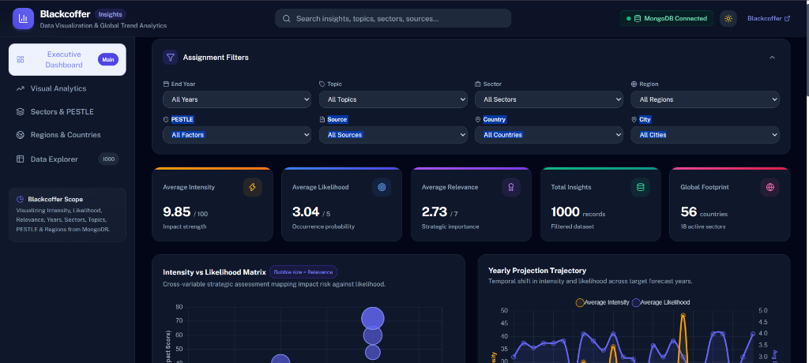

# 📊 Blackcoffer Strategic Insights & Analytics Dashboard

> An interactive full-stack business intelligence and analytics dashboard built to ingest, filter, and visualize complex multidimensional global trend forecasts across Intensity, Likelihood, Relevance, Geographies, and Macro-economic sectors.

[](https://blackcoffer-visualization-dashboard-woad.vercel.app/)
[](https://react.dev/)
[](https://vitejs.dev/)
[](https://tailwindcss.com/)
[](https://www.chartjs.org/)
[](https://nodejs.org/)
[](https://expressjs.com/)
[](https://www.mongodb.com/)
[](LICENSE)

---

### 🌐 Live Deployment
- **Interactive Dashboard**: [https://blackcoffer-visualization-dashboard-woad.vercel.app/](https://blackcoffer-visualization-dashboard-woad.vercel.app/)

---



---

## 📌 Overview

The **Blackcoffer Visualization Dashboard** is an enterprise-grade analytics suite engineered to parse and interpret high-dimensional intelligence records from strategic global foresight reports. It transforms raw multivariate foresight metrics into actionable visual intelligence through interactive charts, dynamic cross-filtering, and an intuitive modern UI design.

Built for executive leadership, strategists, and policy researchers, the platform provides rapid drill-down capabilities across geopolitical boundaries, industrial sectors, projection horizons, and macro-environmental drivers.

---

## ✨ Key Features & Visual Analytics

### 📈 Multi-Dimensional Visualizations
1. **Intensity & Likelihood Matrix**: Bubble and scatter charts mapping Likelihood vs. Intensity with dynamic sizing representing Relevance.
2. **Yearly Trajectory & Forecast Horizons**: Multi-axis trendlines charting project impact velocities over multi-year forecast cycles.
3. **Sectoral & Topic Impact Breakdown**: Ranked horizontal bar charts revealing topic volume, market volatility, and sector vulnerabilities.
4. **PESTLE Macro-Analysis**: Multi-axial radar chart evaluating environmental drivers (*Economic, Environmental, Technological, Political, Social, Industries*).
5. **Geopolitical Footprint**: Interactive doughnut charts and country-ranked metrics mapping insights across continents and national borders.
6. **Executive Metric Cards**: Real-time KPI summaries displaying total insights, aggregated intensity, likelihood scores, relevance index, and country reach.

### 🎯 Comprehensive Cross-Filtering System
- **Temporal Filter**: Projection end-years.
- **Topic Filter**: 90+ granular subject domains (oil, consumption, AI, trade, gas, etc.).
- **Sector Filter**: 18 overarching industries (Energy, Retail, Financial, Manufacturing, etc.).
- **Region & Country**: 23 global macro-regions and 56 distinct sovereign states.
- **PESTLE Categorization**: Dropdown filtering by macro-environmental force.
- **Source Authority**: Filter by publishing agency (EIA, World Bank, Reuters, Bloomberg, etc.).
- **Live Debounced Search**: Instant full-text search across titles, summaries, and impact narratives.
- **One-Click Reset**: Instant clearance of applied filters to return to aggregate state.

---

## 🏗️ System Architecture & Tech Stack

```text
┌────────────────────────────────────────────────────────┐
│             React + Vite Frontend (Vercel)             │
│   • Vuexy-inspired Layout     • Chart.js Visualizations │
│   • Responsive Tailwind CSS   • Cross-Filter Controller│
└───────────────────────────┬────────────────────────────┘
                            │ HTTP REST /api/
┌───────────────────────────▼────────────────────────────┐
│              Express.js / Node.js Engine               │
│   • Aggregation Pipelines     • Filter Synthesis Cache │
│   • Multi-Stage Aggregations  • JSON Ingestion Seeder  │
└───────────────────────────┬────────────────────────────┘
                            │ Mongoose ODM
┌───────────────────────────▼────────────────────────────┐
│                    MongoDB Database                    │
│   • 1,000+ Intelligence Records with Auto-Seeding       │
└────────────────────────────────────────────────────────┘
```

| Layer | Technologies |
| :--- | :--- |
| **Frontend Client** | React 18, Vite 5, Tailwind CSS, Heroicons, Chart.js, React-ChartJS-2 |
| **Backend API** | Node.js, Express.js, CORS, Dotenv |
| **Database & ODM** | MongoDB, Mongoose, Mongo Memory Server fallback |
| **Deployment** | Vercel (Frontend & Serverless API Routes) |

---

## 📁 Repository Structure

```
blackcoffer-dashboard/
├── backend/
│   ├── config/
│   │   └── db.js                 # MongoDB connection & auto-seeder
│   ├── models/
│   │   └── Insight.js            # Mongoose Schema
│   ├── controllers/
│   │   └── insightController.js  # Aggregation pipelines & filtering logic
│   ├── routes/
│   │   └── api.js                # REST API endpoints
│   ├── scripts/
│   │   ├── seed.js               # Standalone DB seeder
│   │   └── testDb.js             # DB health test
│   ├── data/
│   │   └── jsondata.json         # Raw dataset (1,000 records)
│   ├── .env                      # Port & MongoDB URI configuration
│   └── server.js                 # Express server
│
├── frontend/
│   ├── src/
│   │   ├── components/
│   │   │   ├── Navbar.jsx        # Topbar with dark mode toggle & search
│   │   │   ├── Sidebar.jsx       # Vuexy-inspired navigation
│   │   │   ├── FilterBar.jsx     # Dropdown filters
│   │   │   ├── KpiCards.jsx      # Summary metrics
│   │   │   ├── charts/           # Modular Chart.js visualization components
│   │   │   │   ├── BubbleMatrixChart.jsx
│   │   │   │   ├── TrendsLineChart.jsx
│   │   │   │   ├── SectorBarChart.jsx
│   │   │   │   ├── PestleRadarChart.jsx
│   │   │   │   ├── RegionDoughnutChart.jsx
│   │   │   │   └── SourceBarChart.jsx
│   │   │   ├── DataTable.jsx     # Paginated, sortable data explorer
│   │   │   └── DetailModal.jsx   # Insight inspection modal
│   │   ├── services/
│   │   │   └── api.js            # Axios client with Vite proxy
│   │   ├── App.jsx               # Central state & reactive data loading
│   │   └── index.css             # Tailwind styling
│   ├── vite.config.js
│   └── package.json
└── README.md
```

---

## 🚀 Getting Started

### Prerequisites
- **Node.js** (v18 or higher)
- **npm** (or yarn / pnpm)
- *(Optional)* **MongoDB** (If MongoDB URI is not provided, the server can spin up an embedded in-memory MongoDB instance with auto-seeding).

### 1. Backend Setup
```bash
cd backend
npm install
npm start
```
The server will initialize on `http://localhost:5000` and automatically seed records if the collection is empty.

### 2. Frontend Setup
In a new terminal window:
```bash
cd frontend
npm install
npm run dev
```
Navigate to:
👉 **`http://localhost:3000`** (or `http://localhost:5173`)

---

## 📡 REST API Specification

| Method | Endpoint | Description | Query Parameters |
| :--- | :--- | :--- | :--- |
| `GET` | `/api/health` | Service health status | None |
| `GET` | `/api/filters/options` | Returns distinct filter lists | None |
| `GET` | `/api/analytics/kpis` | Aggregated averages & totals | `end_year`, `topic`, `sector`, `region`, `pestle`, `source`, `country`, `city`, `search` |
| `GET` | `/api/analytics/charts` | Formatted chart datasets | Same filter parameters |
| `GET` | `/api/data` | Paginated records list | Same filters + `page`, `limit`, `sortBy`, `order` |

---

## 👨‍💻 Author

**Rishi Kumar**
- **GitHub**: [@kumarrishi4981](https://github.com/kumarrishi4981)
- **Email**: [kumar.rishi4981@gmail.com](mailto:kumar.rishi4981@gmail.com)

---

## 📄 License

This project is licensed under the [MIT License](LICENSE).
